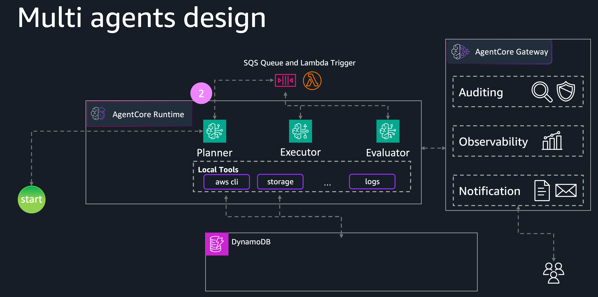
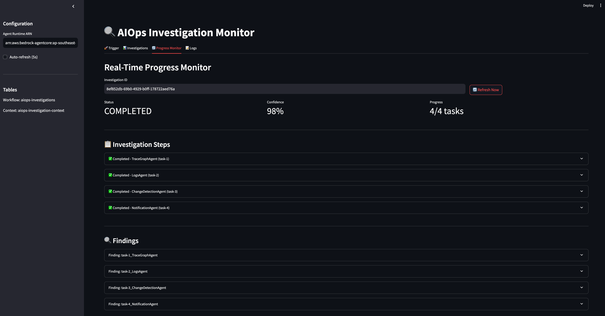
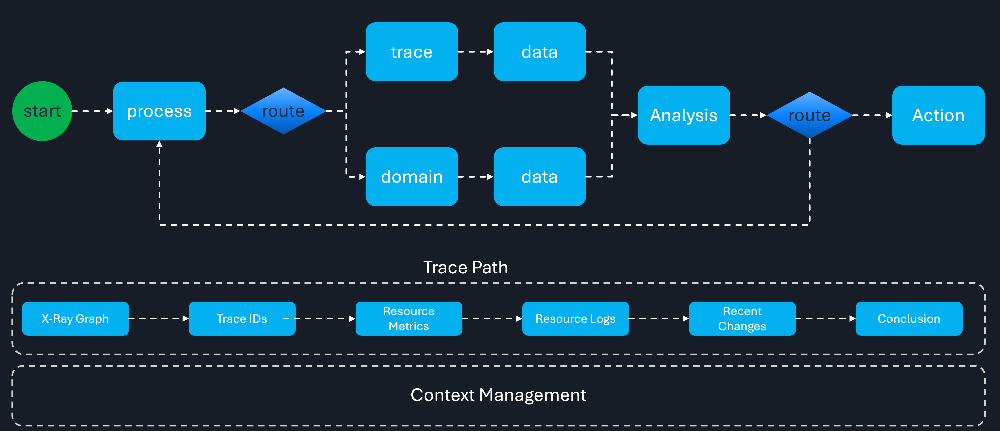
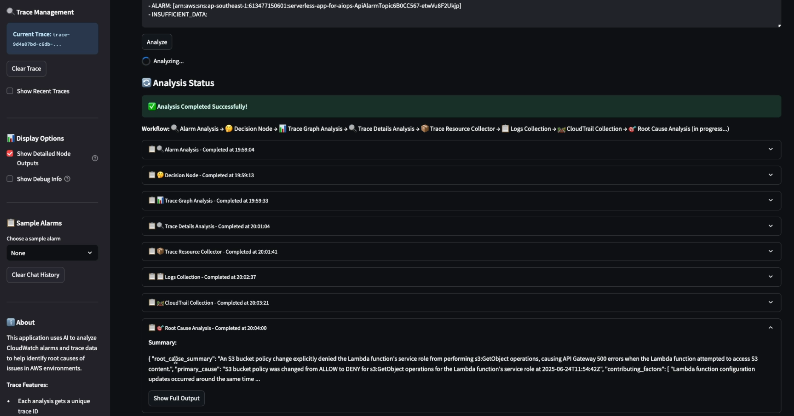

# AIOps Investigation Demos

AI-powered Operations (AIOps) demonstrations for automated AWS infrastructure incident investigation and root cause analysis using multi-agent systems.

## Overview

This repository contains two complementary AIOps implementations that showcase different approaches to automated incident investigation:

1. **Multi-Agent Root Cause Analysis** - Task-driven architecture with adaptive workflows
2. **Workflow-Based Investigation** - LangGraph workflow with decision paths

Both systems leverage Large Language Models (LLMs) and AWS services to automatically analyze CloudWatch alarms, investigate infrastructure issues, and provide actionable insights.

## Demos

### 1. Multi-Agent Root Cause Analysis System

A sophisticated task-driven multi-agent system with MCP (Model Context Protocol) gateways and adaptive workflow generation.

**Key Features:**
- Adaptive workflow generation based on investigation findings
- Feedback loop for continuous re-evaluation
- MCP gateway integration for tool access
- Specialized agents for different investigation domains
- Single-row context tracking with task-prefixed findings

**Architecture:**

```
CloudWatch Alarm → Brain Agent → Tasks → Executor Agent → Specialized Agents → MCP Gateways → AWS Services
                        ↓                      ↓                                          ↓
                   Workflows            Update Context                          Domain-specific Tools
                        ↑                      ↓
                        ← ← ← ← ← ← ← (SQS: RE_EVALUATE)
```

**Specialized Agents:**
- **LogsAgent**: CloudWatch Logs analysis
- **TraceGraphAgent**: X-Ray service graph analysis
- **ChangeDetectionAgent**: CloudTrail change detection + AWS CLI
- **NotificationAgent**: Alert delivery





📖 **[Full Documentation →](multi-agent-demo/README.md)**

📐 **[Architecture Details →](multi-agent-demo/ARCHITECTURE.md)**

---

### 2. Workflow-Based Investigation System

A LangGraph-based workflow system with decision nodes and multiple investigation paths.

**Key Features:**
- LangGraph workflow orchestration
- Decision-based investigation paths (Trace vs Resource)
- Streamlit web UI for real-time progress visualization
- Comprehensive tooling for AWS service data collection
- Multi-layer architecture (WebUI → LangGraph → Tools)

**Architecture:**

```
🔍 Alarm Analysis → 🤔 Decision Node → [Trace Path | Resource Path]
                                      ↓                    ↓
                            📊 Trace Graph Analysis    🤖 Domain Analysis
                                      ↓                    ↓
                            🔍 Trace Details Analysis  📊 Resource Collection
                                      ↓                    ↓
                            🔧 Trace Resource Collector    ↓
                                      ↓                    ↓
                                  📋 Logs Collection ←─────┘
```





📖 **[Full Documentation →](workflow-demo/README.md)**

📐 **[Design Details →](workflow-demo/design/solution-design.md)**

---

## Comparison

| Feature | Multi-Agent System | Workflow System |
|---------|-------------------|-----------------|
| **Architecture** | Task-driven with feedback loops | LangGraph decision-based workflow |
| **Workflow** | Adaptive, generated dynamically | Pre-defined with decision nodes |
| **Tool Integration** | MCP Gateways (AgentCore) | Direct function calls |
| **Context Management** | Single-row DynamoDB with task prefixes | Workflow state management |
| **Re-evaluation** | Continuous via SQS feedback | Linear progression |
| **Deployment** | AgentCore Runtime + Lambda | Standalone application |
| **UI** | Streamlit (planned) | Streamlit (implemented) |

## Error Testing

Both demos utilize the [AWS Sample AI Investigation Demo](https://github.com/aws-samples/sample-ai-investigation-demo) for generating realistic error scenarios and testing investigation capabilities.

## Getting Started

### Prerequisites

- AWS Account with appropriate permissions
- Python 3.8+
- AWS CLI configured
- Node.js and CDK (for multi-agent demo)

### Quick Start

**Multi-Agent System:**
```bash
cd multi-agent-demo
# Follow deployment instructions in multi-agent-demo/README.md
```

**Workflow System:**
```bash
cd workflow-demo
# Follow setup instructions in workflow-demo/README.md
```

## Project Structure

```
sample-ai-investigation-demo/
├── multi-agent-demo/          # Task-driven multi-agent system
│   ├── aiops/                 # Core agent implementations
│   ├── cdk/                   # Infrastructure as Code
│   ├── app/                   # Streamlit web UI
│   ├── tests/                 # Test suite
│   ├── screenshots/           # Demo screenshots
│   ├── README.md             # Detailed documentation
│   └── ARCHITECTURE.md       # Architecture details
│
├── workflow-demo/             # LangGraph workflow system
│   ├── src/                   # Source code
│   │   ├── nodes/            # Workflow nodes
│   │   ├── agents/           # Agent implementations
│   │   └── tools/            # Tool functions
│   ├── prompts/              # Agent prompts
│   ├── design/               # Design documents
│   ├── screenshots/          # Demo screenshots
│   └── README.md            # Detailed documentation
│
├── README.md                 # This file
├── LICENSE
├── CODE_OF_CONDUCT.md
└── CONTRIBUTING.md
```

## Key Technologies

- **AWS Services**: CloudWatch, X-Ray, CloudTrail, DynamoDB, SQS, Lambda, AgentCore
- **AI/ML**: Amazon Bedrock, Claude models
- **Frameworks**: LangGraph, Strands Agents, MCP (Model Context Protocol)
- **Infrastructure**: AWS CDK, Docker
- **UI**: Streamlit

## Use Cases

- Automated incident investigation
- Root cause analysis for CloudWatch alarms
- Infrastructure change detection
- Service dependency analysis
- Log correlation and analysis
- Performance degradation investigation

## Contributing

Contributions are welcome! Please see [CONTRIBUTING.md](CONTRIBUTING.md) for guidelines.

## License

This project is licensed under the MIT-0 License. See [LICENSE](LICENSE) for details.

## Code of Conduct

This project has adopted the [Amazon Open Source Code of Conduct](CODE_OF_CONDUCT.md).

## Security

See [CONTRIBUTING](CONTRIBUTING.md#security-issue-notifications) for more information.

## Resources

- [AWS Sample AI Investigation Demo](https://github.com/aws-samples/sample-ai-investigation-demo) - Error testing scenarios
- [Amazon Bedrock Documentation](https://docs.aws.amazon.com/bedrock/)
- [LangGraph Documentation](https://langchain-ai.github.io/langgraph/)
- [Model Context Protocol](https://modelcontextprotocol.io/)

---

**Note**: These demos are for educational and demonstration purposes. Adapt security, error handling, and resource configurations for production use.
